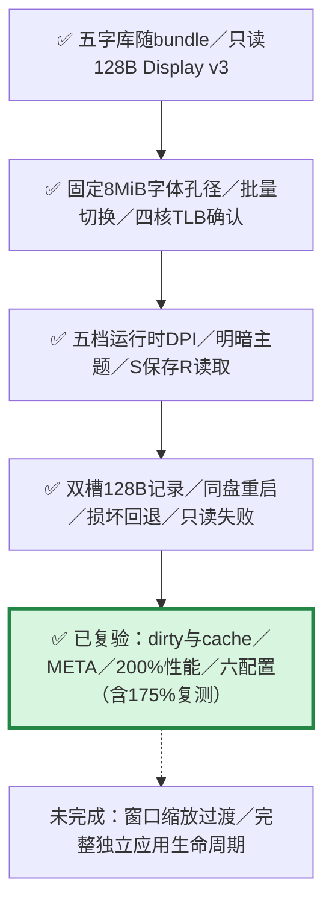
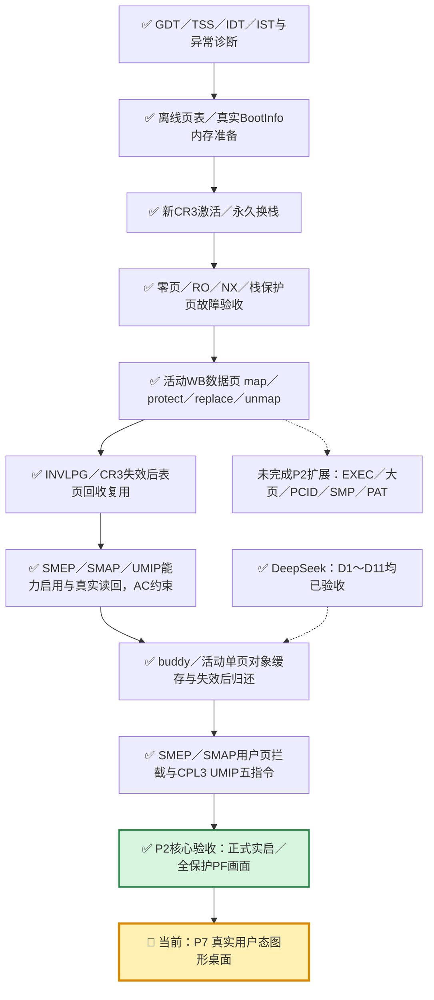
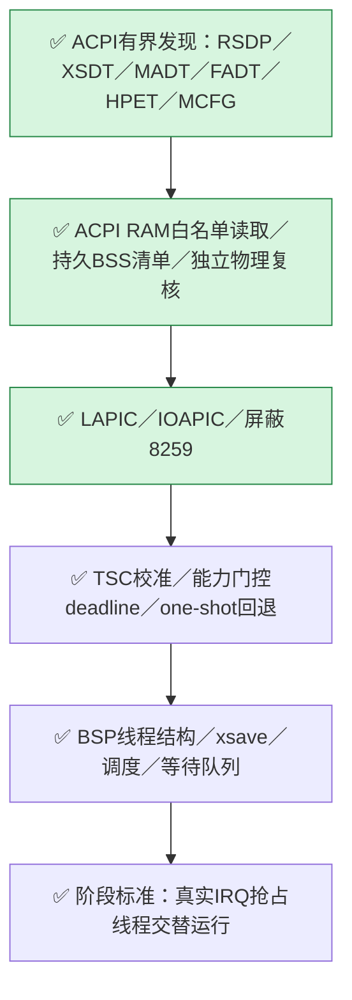

# DongOS 整体任务图

更新于2026-10-17。**P7运行时五档DPI与双槽主题持久化已实现并复验**：27项宿主检查零skip，五次设置客体加六种桌面配置共11个场景通过；正式12次启动含175%首次时钟校准离群失败及相同镜像一次复测通过，原失败保留。运行时200%拖动59.9420FPS、最慢8.7174ms。总记录为`build/test/p7-settings/validation-summary.json`。P7窗口缩放过渡、独立应用生命周期及P6通用调度/DAG/KVM快启仍未完成；时钟单窗口校准抗抖动为已记录的后续问题。见[桌面记录](graphical-desktop.md)、[四核记录](smp-runtime.md)和[完整计划](../PLAN.md)。

本轮P7接入与验收：

设置证据：`build/test/p7-settings/qemu/run-25bd369c2690/result.json`，五次正式启动；总记录`build/test/p7-settings/validation-summary.json`包含27项宿主检查、六配置回归和175%首次校准异常的失败与复测记录。聚焦设置窗口用 `-` / `=` 循环五档、`T` 切换主题、`S` 保存、`R` 读取；启动优先有效 `DESK0.CFG` / `DESK1.CFG`，否则使用镜像的 `--scale` 默认。双槽保留旧有效记录，写入经FLUSH和完整回读后发布新序号，不承诺物理掉电时的FAT原子性。历史性能见桌面文档的历史段落。

P2内部进度：

原runtime0路径仍限BSP；runtime6/7已接入保持在线的AP与IPI应答屏障。修改者仍是BSP、IF/AC关闭、PCID/PGE关闭，数据页保持WB/NX；支持的SMEP/SMAP/UMIP控制位已开启。新Owner已连接buddy→活动映射→定长对象→全空撤销/失效→归还，含失败保留与重试。独立测试镜像已完成用户页SMEP/SMAP拦截、AC放行及真实CPL3 UMIP五指令拒绝/关闭对照；没有扩展生产USER/EXEC接口或引入用户服务。多核shootdown已通过；动态执行别名、大页、PCID及PAT扩展继续保留。实现与证据见[权限专项](user-permissions.md)、[对象缓存集成](page-cache.md)、[CPU硬化记录](cpu-hardening.md)、[活动页表记录](active-paging.md)，首次激活记录见[paging-activation.md](paging-activation.md)。

P3内部进度：

ACPI表在旧P1低4GiB映射退役前读取，清单复制到内核BSS后供新CR3使用。随后runtime3启动APIC与定时抢占，正常、无HPET、无XSAVE及正式版四配置均通过；有界证明结束后停timer并清IF返回原continuation。以上是P3独立证明的终态；runtime6/7随后已启动并保持AP在线，runtime4/5/7已接入用户服务。详细证据见[ACPI记录](acpi-discovery.md)与[P3运行时](interrupt-runtime.md)。

DeepSeek：D1～D11均已验收。14:19复验确认D10最后一处count后即时BG已有效，永久两项通过、零skip，唯一旧坏写控制两模式均立即拒绝、0漏检，详见[最新验收](../deepseek-works/reviews/2026-10-17-acceptance-1419.md)。原有限剩余全部关闭；P2核心现已验收，五项扩展继续保留，本轮不增加DeepSeek任务编号。

语言线L2（优化与调试信息）计划与P3～P6并行；L3（自举）在P5之后，均尚未进入本地完成阶段。
