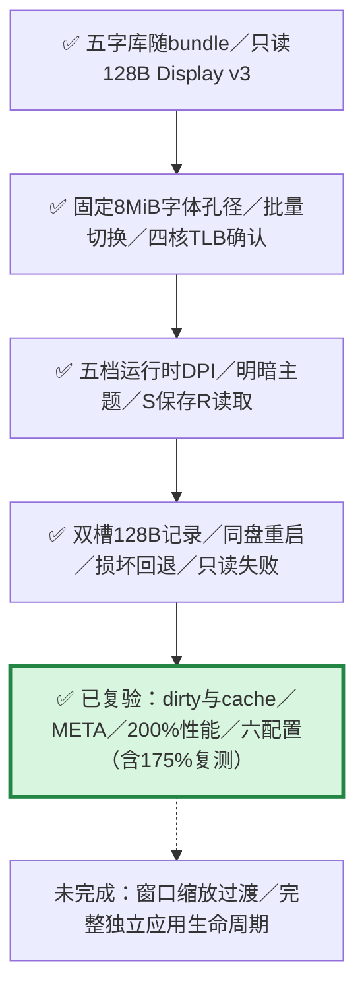
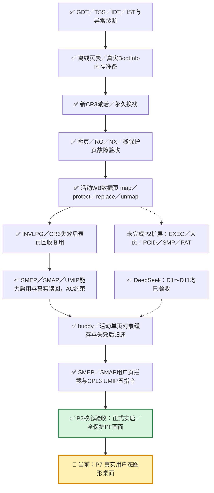
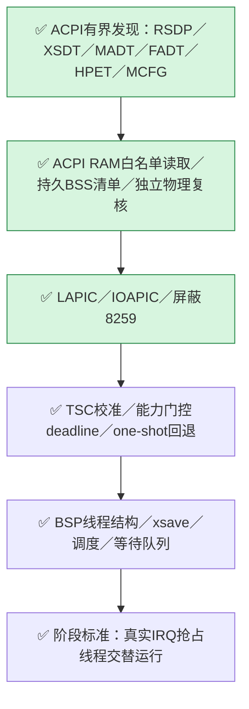

# DongOS 整体任务图

本轮17份缺失任务书、CX6同号异义和CX14/CX15旧状态均已处理完成。CX14 integrated rev7，CX15 integrated rev8；CX6 integrated rev9，已恢复读取器契约，分离5条原NASM事件，耗时恢复为1轮/265秒，原始事件全部保留。协调器issues=0；核对时间2026-10-22T09:18:41+08:00。

当前MCP快照共164项活动任务：19 accepted、140 integrated、3 submitted、1 in_progress、1 rework。本轮同时观测到其它客户端新增5项并行任务，其状态按实时MCP继续变化，本轮没有接管或改动它们。

完整阶段表及证据见[整体任务图](../../coordination/dongos_works/progress-map.md)与[恢复报告](../../coordination/dongos_works/reviews/2026-10-22-task-recovery/README.md)。

以下保留原有记录；其中日期、任务数量、机器路径和“当前/下一步”均属于各自历史检查点，最新状态以上述记录及协调器为准。

最新接续（2026-10-21T23:25:35+08:00）：P2BUILD5已独立验收并本地集成rev6：正式16项零skip/source_stable；补齐正式构建NASM分组帮助探测，真实NASM2/3兼容测试通过。NASM3完整release runtime7构建、实际1/4核共享大页与四核桌面/P5两观察、独立raw replay均通过。正常kernel2006608B/余90544B；316inputs匹配主目录。与旧NASM2非逐字一致，19ASM源相同，编码/对齐差异已审查并保留双份证据。MCP快照132项=109 integrated+19 accepted+3 in_progress+1 todo。Claude EXEC in_progress rev10（R1返修），WC in_progress rev2；DeepSeek L3A在途rev2，L3待依赖验收。P2 EXEC/WC消费者、任意调度后多CR3及WC真实性能仍未关闭。不提交/推送/建PR。 见[整体任务图](../../coordination/dongos_works/progress-map.md)和[P2BUILD5集成回执](../../coordination/dongos_works/reviews/2026-10-21-P2BUILD5-integration.json)。

2026-10-21 02:26 历史G6检查点（由顶部本地快照接续）：原main合并/同步检查点19e1a19及准确候选真实双启证据保留；GitHub新push状态本轮未重新查询，不能将旧in_progress快照当作当前状态。详见[G6执行/合并报告](../../coordination/dongos_works/reviews/2026-10-21-g6-ci-execution.md)。

2026-10-20 23:28 历史检查点（由顶部取代）：主线仍为244b18c；C52新正式复验6项/0skip、149.843秒后accepted rev13→integrated rev14，CXNASM3正式10项/0skip、2.859秒后accepted rev5→integrated rev6，两者source_stable/process_stopped/execution_exited均true，真实代码早随PR8合入。新增手动Cursor任务P5CTX1 todo rev1，7项write_paths全部在本人works副本，验收后由Codex实际集成，根kernel禁止worker直改。当前122项活跃任务（102 integrated、19 accepted、1 todo、0 submitted），总138项含16归档；foreign161仍不导入。23:13“DB未变”的[合并同步冻结报告](../../coordination/dongos_works/reviews/2026-10-20-pr8-merged-local-sync.md)保留当时证据，本轮通过正常新rev和新任务继续推进，没有覆盖历史。P5 partial、L3B complete、L3C partial保持；G6 runner准备条件已核清，但CI尚未接入或运行，report目录的workflow提案不代表已生效，不等完整P5。合并后完整CI39444684378仍运行。详见[最新整体任务图](../../coordination/dongos_works/progress-map.md)及[本轮P5/G6安排](../../coordination/dongos_works/reviews/2026-10-20-p5-g6-next-actions.md)（报告及静态提案已保存，workflow未安装或运行）。

2026-10-20 入口更新：当前 P0–P9 / L0–L3 状态请查看 [协作区最新任务图](../../coordination/dongos_works/progress-map.md)及其 [roadmap.json](../../coordination/dongos_works/roadmap.json)。按 [P5/P6 工程交接](p5-p6-engineering-handoff.md#接手顺序与停止条件)，当前优先推进 P5；L3 宿主编译链与客体自编译门禁见 [语言线当前记录](language-l2-l3.md#l3-完成路径与当前门禁2026-10-21)。协作任务状态以协调器实时查询为准。

21:31 历史快照（已由顶部23:28当前记录取代）：当时PR#7已合入远端main，PR#10完整CI通过待合；PR#8仍有CI/本地状态重叠及客体桥缺陷，PR#3独立暂缓。当时远端main为`1dfebe1`、本地检出为`345570f`；[历史GitHub快照](../../coordination/dongos_works/reviews/2026-10-20-roadmap-github-checkpoint.json)仅用于追溯，不代表当前状态。

以下保留 **2026-10-17 历史快照**，用于追溯当时验收范围。图中的 PCID 待补、P8 待做及 L2/L3 未完成等文字均为当时状态，不代表当前进度；后续实现、已记录证据与待验收环节以以上最新版入口为准。

更新于2026-10-17。**P7运行时五档DPI与双槽主题持久化已实现并复验**：27项宿主检查零skip，五次设置客体加六种桌面配置共11个场景通过；正式12次启动含175%首次时钟校准离群失败及相同镜像一次复测通过，原失败保留。运行时200%拖动59.9420FPS、最慢8.7174ms。总记录为`build/test/p7-settings/validation-summary.json`。P7窗口缩放过渡、独立应用生命周期及P6通用调度/DAG/KVM快启仍未完成；时钟单窗口校准抗抖动为已记录的后续问题。见[桌面记录](graphical-desktop.md)、[四核记录](smp-runtime.md)和[完整计划](../PLAN.md)。

```mermaid
flowchart LR
    P0["✅ P0 工具链／UEFI入口"] --> P1["✅ P1 引导器"]
    P1 --> P2["✅ P2核心验收通过／扩展未完成"]
    L1["✅ L0／L1 语言与基础库"] --> P2
    P2 --> P3["✅ P3 ACPI／中断／抢占线程"]
    P3 --> P4["✅ 百万IPC／PCID和init待补"]
    P4 --> P5["✅ 三个CPL3服务／双启动文件持久化，详细项未全完"]
    P5 --> P6["部分通过：P6 四核／TLB，调度与快启待补"]
    P6 --> P7["📍 P7运行时DPI／双槽设置已复验"]
    P7 --> P8["待做 P8 USB／真机"]
    P8 --> P9["待做 P9 安全加固"]
    P9 --> P10["后续 P10 持续完善"]
    style P2 fill:#d7f5df,stroke:#238645,stroke-width:2px
    style P3 fill:#d7f5df,stroke:#238645
    style P4 fill:#fff0b3,stroke:#d68a00,stroke-width:3px
```

本轮P7接入与验收：

设置证据：`build/test/p7-settings/qemu/run-25bd369c2690/result.json`，五次正式启动；总记录`build/test/p7-settings/validation-summary.json`包含27项宿主检查、六配置回归和175%首次校准异常的失败与复测记录。聚焦设置窗口用 `-` / `=` 循环五档、`T` 切换主题、`S` 保存、`R` 读取；启动优先有效 `DESK0.CFG` / `DESK1.CFG`，否则使用镜像的 `--scale` 默认。双槽保留旧有效记录，写入经FLUSH和完整回读后发布新序号，不承诺物理掉电时的FAT原子性。历史性能见桌面文档的历史段落。

P2内部进度：

原runtime0路径仍限BSP；runtime6/7已接入保持在线的AP与IPI应答屏障。修改者仍是BSP、IF/AC关闭、PCID/PGE关闭，数据页保持WB/NX；支持的SMEP/SMAP/UMIP控制位已开启。新Owner已连接buddy→活动映射→定长对象→全空撤销/失效→归还，含失败保留与重试。独立测试镜像已完成用户页SMEP/SMAP拦截、AC放行及真实CPL3 UMIP五指令拒绝/关闭对照；没有扩展生产USER/EXEC接口或引入用户服务。多核shootdown已通过；动态执行别名、大页、PCID及PAT扩展继续保留。实现与证据见[权限专项](user-permissions.md)、[对象缓存集成](page-cache.md)、[CPU硬化记录](cpu-hardening.md)、[活动页表记录](active-paging.md)，首次激活记录见[paging-activation.md](paging-activation.md)。

P3内部进度：

ACPI表在旧P1低4GiB映射退役前读取，清单复制到内核BSS后供新CR3使用。随后runtime3启动APIC与定时抢占，正常、无HPET、无XSAVE及正式版四配置均通过；有界证明结束后停timer并清IF返回原continuation。以上是P3独立证明的终态；runtime6/7随后已启动并保持AP在线，runtime4/5/7已接入用户服务。详细证据见[ACPI记录](acpi-discovery.md)与[P3运行时](interrupt-runtime.md)。

DeepSeek：D1～D11均已验收。14:19复验确认D10最后一处count后即时BG已有效，永久两项通过、零skip，唯一旧坏写控制两模式均立即拒绝、0漏检，详见[最新验收](../../coordination/dongos_works/deepseek-works/reviews/2026-10-17-acceptance-1419.md)。原有限剩余全部关闭；P2核心现已验收，五项扩展继续保留，本轮不增加DeepSeek任务编号。

语言线L2（优化与调试信息）计划与P3～P6并行；L3（自举）在P5之后，均尚未进入本地完成阶段。
