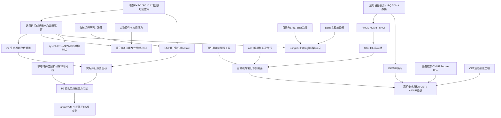

# 剩余计划、依赖与可并行边界

2026-10-18执行更新：P4正式能力附带/通知与对象持有共享页已通过R5正常内核实际CPL3验收，用户库采用Dong类型化封装及SysV汇编桥；百万IPC原门槛保留。P6普通用户多核已完成正向、无效返回隔离及省略xstate负控共六次启动，真正每核抢占/迁移/退休和tickless/IPI证据见 `build/test/integration-promotions/p6-r5-user-actual-acceptance.json`。正常版能力/共享、AHCI MSI同盘读写/FLUSH和驱动UD2退出五次启动由 `p4-p5-r5-normal-actual-acceptance.json` 封存；故障DMA仍持有，同boot安全回收/重绑定继续未完成。R6普通内核已构建，GUI冒烟和1/2CPU各同盘两次回退通过；真实init跨AP首次启动观察、完整GUI/USB/VMware回归继续执行。完整GUI首轮输入失败及启动观察首轮零epoch过渡态失败均保留，不写作通过。P7既有功能、P8受控USB/trace和旧VMware五组十次启动的历史验收不作废，也不替代新版本回归。全部进展与失败见[集成记录](process-integration.md)。Linux/KVM性能及台式机/笔记本外部验收仍缺环境，不由VMware或TCG替代；以下初始盘点保留作历史。

2026-10-18语言线优先级更新：用户要求先补 L2/L3。可选标量 SSA/CFG、验证、常量/分支/死码优化、有限内联及分配已接入；初始安静性能五项仅一项达原1.20门槛，L2整体未完成。DWARF及真实GDB源码断点/单步/变量/回溯子项通过；两处未初始化遮蔽缺陷已独立复验关闭。Dong原生完整词法器通过差分，字符串未完成前发布的测试漏检也已补上有效负控，但L3完整解析/语义/后端/目标工具链/客体自编译仍未完成。完整语言套件380项通过、零skip；本轮没有新OS构建或VM启动。当前证据及下一步见 [语言线记录](language-l2-l3.md)，下方语言三行仍是原始盘点历史。

盘点日期：2026-10-17。用户已明确：**本轮完成范围为 P0–P9，P10 另定范围**；并行语言/工具线保留既有计划。本文件根据 `PLAN.md` 的阶段复选框、阶段验收标准，以及当前源码和后续验收文档编制；它是执行清单，不是新的完成声明。本次盘点没有构建内核、运行客体或修改现有阶段状态。盘点时共有 **33 个未勾条目，其中 3 条 P10 仅作参考，不计入本轮完成/验收范围，其余 30 条属于本轮执行清单**。以下全部保留便于核对。P7 几何过渡正在当前主线收尾，应以其最终客体复验后更新的 `PLAN.md` 为准。

盘点后更新：P0 的 USB 制作工具依赖和 P8 的启动镜像生成已关闭，采用经过独立解析的纯 Python GPT/FAT 流程替代该处 mtools。镜像实际由 QEMU 固件从 xHCI USB 启动到桌面，见 [USB 证据](usb-boot-image.md)。七样本时钟校准已接入并通过 HPET/PM 两客体，见 [时钟证据](clock-calibration.md)。P7 缩放功能两客体、半透明主题三客体、SSE2回退、设置五客体、PS/2与平板基线均通过；功能复选框已关闭。无断点精确遮挡测量将四窗口DPI移动帧降至约16–23ms，来源帧仍高至32.8ms，不能称动画恒定60Hz；200%实际拖动为60.0216FPS、最慢7.0423ms。电源已正式接线并通过 Q35 关机/重启四次实际启动和原盘持久化，两个恶意服务的21项权限负控也已通过，见 [电源证据](power-management.md)；init DAG 仍为纯策略原型。VMware 16 的 IOAPIC 与 AHCI 接线现已通过实际执行，完成 P3/P6 四核/TLB、五服务及双启动shell写/读/列目录/同步/原盘持久化；两个桌面就绪标记出现，未据此声明VMware像素/帧率验收。QEMU严格AHCI两启动与同镜像VirtIO电源四启动也通过，见 [跨 VM 记录](vmware-validation.md) 与 [AHCI边界](ahci.md)。路径/LFN已正式接入：全树审计、UTF-8路径、目录与长名实际NVMe读写/FLUSH/同盘双启动全部通过；9个错误路径逐项整盘SHA不变、66个写/FLUSH主机故障点通过，见 [FAT32验收](fat32.md)。NVMe核心、callback执行器和内核授权已正式接入；QEMU实际写/读/FLUSH、同盘双启动、完整USER叶物理别名检查通过，同镜像AHCI两启动和VirtIO电源四启动回归也通过，见 [NVMe验收](nvme.md)。P5存储驱动的受控子集已关闭，物理盘和通用设备生命周期仍另验；格式器与高亮15项正式测试通过，见 [工具文档](dongfmt.md)。VMware 不替代 Linux/KVM 或两台物理机标准。原始盘点表保留，当前复选框以 `PLAN.md` 为准。

P3 的四个复选框和实际时间片抢占验收均已完成。`README.md`“下一步”及 P2/P3 文档中的“尚未开始”“仅 BSP”等历史段落，不覆盖后来的 P4/P5/P6/P7 证据。相反，P4/P5 的里程碑通过也没有关闭其全部详细条目。P2 扩展只剩四项：SMP shootdown 已由后来的四核验收关闭。

验证位置记号：**H** 为当前 Windows 宿主可运行的独立模型/原生测试；**V** 为当前 QEMU/TCG 客体可验证的实际执行；**E** 为需要另一个虚拟化环境、Linux/KVM 或物理设备的最终验收。H 不能替代 V，V 不能替代 E。下面的“已有”只表示源码和既有证据存在，并非本次重新执行。

## 初始逐项盘点（增量进展见上文与PLAN.md）

| 项目 | 已有实现与证据 | 仍需交付及验收位置 |
| --- | --- | --- |
| 语言 L2：SSA、寄存器分配、常见优化 | `lang/dongc/` 是完整 L1 前端及直接 NASM 后端；目前没有 SSA/优化流水线 | 类型化 IR、CFG/SSA、验证器、寄存器分配、常量/控制流/死代码优化；保持 debug 检查、求值顺序、volatile/原子/屏障及双 ABI 契约。独立差分执行与坏实现控制；关键基准距手写汇编不超过 20% 的原标准保留。H/V |
| 语言 L2：调试信息、gdb 源码调试 | AST 和诊断已有源码位置；输出只有汇编符号及布局 JSON | 源文件/行表、函数/变量位置、栈展开信息及可复现路径；实际 GDB 按 Dong 源码断点/单步、查看变量并跨调用。不能只检查 `.debug_*` 节存在。H/V |
| 语言 L3：Dong 重写编译器并在 DongOS 自举 | 宿主编译器是 Python；当前 OS 没有可运行的 Dong 编译器 | 先用 Dong 实现完整编译流水线和输入/输出、工作内存，再在宿主做双编译器一致性；接入 OS 文件/进程后在客体编译自身，比较规定的产物一致性。不是把 Python 编译器装进镜像即完成。H/V |
| 工具：dongfmt、VS Code 高亮 | 仓库未见格式器或编辑器扩展目录 | 无语义改变、幂等、注释/Unicode/错误输入行为明确的格式器；扩展语言声明及语法高亮测试。可与内核工作独立进行。H |
| P0：mtools 等后续工具 | NASM/LLVM/QEMU 已有；本次 PATH 未发现 `mcopy`/`mformat`，`.tools` 顶层亦无 mtools | USB 镜像流程先确定原工具要求和 Windows/Linux 可复现来源；若采用已有 Python FAT 生成器扩展，则应明确记录对 mtools 的替代范围并同步计划，不能静默勾掉安装任务。H/E |
| P2：动态执行别名策略 | 用户 ELF 静态装载已有 RX 代码和受控写别名处理；通用活动页表接口仍拒绝 USER/EXEC | 建立物理页所有权、所有别名的 W^X、写权限撤销/失效后再授 EXEC、跨核回收/失败保留协议；用预热取指和陈旧可写别名反例验证。静态装载成功不等于通用动态 EXEC 已实现。H/V |
| P2：2 MiB 大页与拆分 | `mm.paging`/`active_paging` 只管理 4 KiB 私有树 | 对齐/权限/缓存类型一致的大页映射、2 MiB↔4 KiB 拆合、完整失败不变、A/D 处理、失效后表页回收；独立原始页项遍历和实际预热访问。H/V |
| P2：PCID 生命周期与精确失效 | 每个服务已有私有根；切换重载 CR3；PCIDE/PGE 关闭 | CPU 能力门控、PCID 分配/代际/回收、根绑定、跨 CPU 激活历史、精确失效/回收屏障；tag 复用暖 TLB 反例必须实际拒绝。与 P4 同一依赖，不重复另造一套机制。H/V；真实 CPU 补验 E |
| P2：PAT 写合并 | GOP 当前为 UC，RAM 为 WB；AP 已复制 BSP MTRR/PAT 并逐项读回 | PAT/MTRR 有效类型与冲突别名策略、全核一致更新、缓存维护/迁移、受控 WC 映射和不可缓存设备隔离；真实 PAT/MSR/PTE 与像素/性能复验。不能把非临时写指令等同 WC。H/V；实际显示硬件 E |
| P4：地址空间/PCID、ELF、栈/地址随机化 | `exec.elf` 验证 ET_EXEC/ET_DYN/相对重定位；真实服务独立 CR3、RX/RW/NX、双 guard。TSC 位选装载基址；runtime4 栈位移，runtime5/7 栈位置按服务固定 | 拆开本聚合项：保留已完成 ELF/私有根事实；补 PCID、可靠熵源/失败策略、用户布局随机化及可复用的创建/销毁/回收，不把 `read_tsc` 当安全熵源。H/V；真实熵源补验 E |
| P4：libasm、init、IPC 压测 | `services/lib/sys.dg`/`syscalls.asm` 已有用户接口；百万次真实 IPC、XSAVE/FXSAVE 两配置通过 | 冻结可给一般应用使用的用户库；通用 init 服务/配置/就绪协议、进程退出和故障处理。已有百万 IPC 结果不用重复当作全新工作；扩展后应回归。H/V |
| P5：PCIe 设备管理/按设备启动/IRQ 和寄存器授权 | `drivers.pci` 有 ECAM 遍历；`user.devices` 为所选 VirtIO 块和输入设备发放独立 BAR/DMA 能力 | 当前是固定角色接线；需独立设备管理服务、驱动匹配/启动、通用 IRQ 绑定/通知/EOI/屏蔽、授权撤回和热故障处理；涵盖不支持和重复设备。H/V；机器拓扑 E |
| P5：i8042 键盘 | P7 已有独立 CPL3 `drivers.input_service`，真实初始化 i8042、轮询 PS/2 键鼠、共享事件队列，实际键入/拖动已过 | 不应列为“尚无键盘”。核对该条验收范围后补键盘错误/丢包恢复及 P5 shell 接线；若按通用设备服务设计交付，补 IRQ1/12 通知和权限隔离。当前轮询实现可保留为明确回退。H/V；真实 i8042 E |
| P5：virtio-blk→AHCI→NVMe | 现代 VirtIO PCI/块 CPL3 服务已有真实读写/FLUSH、独立 DMA 租约及双启动持久化 | AHCI 和 NVMe 驱动未见源码；各自需寄存器/队列核心、设备服务接线、超时/坏完成/复位、DMA 生命周期、同盘双启动持久化。QEMU 仿真可先做，真机仍需各控制器/盘。H/V/E |
| P5：FAT32 服务 | `fs.fat32`/`fs.service` 已做根目录 8.3 create/read/write/truncate/delete、镜像 FAT、clean/FLUSH 和真实落盘 | 既有服务不能重写成空白任务；剩余子目录遍历/创建、路径/句柄权限、LFN 写入与错误恢复规则。独立解释磁盘簇链/FAT 两副本、碎片/坏盘/故障注入/重启，不承诺掉电事务。H/V |
| P5：shell 常用命令、另一 VM 复测 | `shell.main` 已有 help/ls/cat/write/touch/rm/sync/exit；真实串口 shell 写文件重启可读 | 结合目录/进程能力补路径、参数、程序启动、错误/退出状态等可用行为；按原计划在 VirtualBox 或 VMware 的 EFI/磁盘/输入配置复测。当前 PATH 未发现其管理命令，不能将 QEMU 第二次运行称作跨 VM。H/V/E |
| P6：每核运行队列/负载均衡 | `sched.core` 有 BSP 优先级/等待队列；四核独立计算及共享根 TLB 域已验收 | 把通用线程实际送上 AP，持续抢占、每核运行队列、迁移/唤醒/抢占禁区、锁与负载平衡；多进程 CR3/xstate/内核栈/中断状态随线程一致。AP 在线或四核计算证明不等于 AP 调度。H/V |
| P6：服务依赖图/并行启动 | `user.services.prepare` 静态装载固定 3/5 服务；没有通用 init DAG | 纯 DAG 验证/就绪推进可先独立完成；再由 init 实际并行启动、只给就绪依赖分发能力，处理循环/失败/超时/重试/重启。四核用户调度前可以先逻辑并行，最终须有实际并行证据。H/V |
| P6：启动计时日志/自动测试/四核压力 | 已有若干 TSC 报告及桌面 READY；当前 175% 曾出现单窗口校准离群。四核计算压力已有专用证据 | 先加固参考时钟校准，统一固件交接→kernel→服务就绪→shell/桌面第一帧时间线，再做自动回归/负载压力。**原门槛仍是 Linux/KVM 引导器至 shell ≤0.5 秒**；Windows/TCG 不能关闭此门禁，不计入固件自检或以主机启动耗时替代。H/V/E |
| P7：窗口缩放过渡 | 当前工作树已加入 `transition.dg`/`transform.dg` 及 compositor 接入；原生测试和只读栈审查已通过 | 主线正在完成真实动画中间帧/终点、DPI 过程、反向/点击拖动打断、实际 GOP 像素和 60Hz 回归。未看到最终记录前保持待验收，不与 root 并行改 compositor。H/V |
| P7：控件库及完整应用行为 | 已有 widgets/render/windows/theme；四窗口和任务栏可交互，编辑器能落盘，设置持久化已过 | 把“完整”拆成可验收清单：焦点/捕获/键盘导航、列表/滚动/选择、打开/保存文件名与错误反馈、终端真实 shell/程序会话、文件管理打开/创建/删除/路径、编辑器 UTF-8 光标编辑和脏状态、设置可用参数。当前 `apps.dg` 是进程内模型，不能算独立终端/完整文件管理器。H/V |
| P7：图形应用独立进程/启动退出崩溃恢复 | 仅 shell/FS/block/compositor/input 五个静态进程；图形四应用都在 compositor 内 | 客户端/合成器窗口协议、私有应用 CR3、共享帧/提交/resize lease、按代际撤销能力；init 启动/退出/异常隔离/重启；关闭应用必须只回收其资源，陈旧提交不能影响新窗口。依赖通用进程和 DMA/共享内存回收策略。H/V |
| P8：xHCI、USB HID、U 盘 | 未见 xHCI/USB/HID/USB 存储源码；已有 PCI、DMA 和通用输入事件可复用 | xHCI 命令/传输/事件 ring、端口/设备枚举、控制传输和故障/撤回；HID 描述符/键鼠；USB mass storage/SCSI/块接口。QEMU 可先测 xHCI/HID/仿真 USB 盘；真实 USB3/Hub/拔插/控制器和设备组合 E |
| P8：make usb | 现有 `make_fat32_disk.py` 只造 FAT32 数据 superfloppy；Makefile 没有 usb 目标 | 独立生成含 ESP、`EFI/BOOT/BOOTX64.EFI`、DONGOS.IMG/SERVICES.BIN 的可引导镜像，几何/分区/启动路径可独立验证，接入 `make usb`。先用镜像客体启动，再交付写盘产物；实际写 U 盘另需用户明确指定目标设备。H/V/E |
| P8：ACPI S5 关机、FADT 重启 | Inventory 有 FADT、DSDT 地址、Reset GAS/value；没有 AML/S5 解析或执行关机服务 | 有界解析必要 AML `_S5`、PM1/GAS 与权限；重启 GAS 校验和受控写入；QMP 观察真实 shutdown/reset，禁用伪造 debug-exit 成功；复杂 AML/硬件差异要失败关闭或明确扩展。H/V/E |
| P8：台式机和笔记本实测 | 当前证据都是 Windows/QEMU；没有两台物理机实启记录 | 至少一台支持 UEFI 的台式机和一台笔记本、可用 U 盘/可恢复写入、固件启动控制、显示/键鼠/存储信息和日志采集；需要设备所有者操作和到桌面的实证。必须核对 GPU GOP/USB/存储/ACPI，不能用两个 VM 代替。E |
| P9：自有密钥签名、OVMF/真机导入公钥 | 现有 EFI 是未签名模式，运行使用关闭 Secure Boot 的模板；镜像 SHA 校验已有 | 建立私钥受控保存、签名产物、可信公钥导入和拒绝篡改链；OVMF Secure Boot 可自动化独立测试，真机需固件 Setup/Custom 模式控制和可恢复密钥备份。不得将模板全局改写或把签名密钥提交仓库。H/V/E |
| P9：IOMMU 限制 DMA | 当前 BAR/DMA 句柄隔离不等于硬件 DMA 重映射；没有 DMAR/IVRS 驱动 | ACPI 发现/保留 IOMMU 寄存器、DMA domain/页表、设备绑定、失效/故障处理、撤销后回收；QEMU 配置能力范围内可做 VT-d 负控，物理 Intel VT-d/AMD-Vi 及真实恶意越界 DMA 验证依赖硬件。H/V/E |
| P9：CET 影子栈/IBT、内核基址随机化 | 少量手写入口有 endbr64；preflight 明确排除继承 CET；内核固定链接 `0xffffffff80000000` | 编译器全部间接目标 endbr、内核/用户影子栈及切换/中断/#CP；真实硬件能力门控；引导器可靠熵和内核/boot resource/所有符号与映射重定位。零星 endbr 或用户 PIE 位移不能关闭此项。H/V；支持 CET 的执行环境 E |
| P9：syscall/IPC 模糊测试 | 已有有效独立坏客体/原生模型；没有通用 fuzz harness/24 小时运行记录 | 结构化生成、持久种子、可最小化复现、超时/重启/资源泄漏观察、权限边界 oracle；在真实入口持续 24 小时无崩溃，并保留覆盖/运行时间/原始失败证据。短 smoke 或纯 parser fuzz 不替代原阶段门槛。H/V，完整持续运行需要实际时长 |
| P10：网卡与精简 TCP/IP（本轮排除，参考） | 未见 NIC/网络栈源码；当前 QEMU 启动默认 `-net none` | 后续另定：可先 VirtIO-net；以太网/ARP/IPv4/ICMP/UDP/TCP、校验/长度/重传/状态机、网络服务能力；独立数据包模型、QEMU 网络互通和真实 NIC。H/V/E |
| P10：HD Audio（本轮排除，参考） | 未见 HDA/声卡服务源码 | 后续另定：PCI/寄存器、CORB/RIRB、codec widget 路由、DMA 缓冲/时钟、音频服务/混音；QEMU 捕获音频和物理 codec/扬声器/插孔验证。H/V/E |
| P10：中文输入法、完整 ACPI、更多应用（本轮排除，参考） | 已有 UTF-8 渲染/编辑组件；没有输入法、AML 解释器、睡眠/电池服务 | 后续另定输入法、睡眠/电池与应用的具体子集及验收。本轮不开发或以此阻止 P0–P9 收尾。P10 原标准“按需迭代，无固定终点”保持。H/V/E |

## 当前集成入口

跨VM存储子项与NVMe实际接线均已取得正向证据，目录/LFN正式接线和实际同盘双启动现也通过。NVMe已复验BME前可信快照、BAR权限、DMA映射和真实SQ/CQ完成；这不替代物理盘、VMware NVMe、多队列、IRQ及安全退休/回收。未实现安全队列退休前，故障仍须持有全部DMA，不得回收后重试。AHCI/NVMe保留各自协议，不共享完成条件。

历史只读scanner原型与设计保留在 `build/test/fat-integration-design/`。当前正式 `fs.fat32` 已做两遍有界DFS全树审计、逐组件存在性/目录检查、跨扇区/簇LFN读写、mkdir/删除、短别名冲突和dirty先持久化；路径v2、kernel accepted-ticket peer及每客户端独立通道完成接线。正常runtime7镜像 `build/test/fat-paths/builds/build-0eb2e28973e5/esp` 的实际目录/LFN两启动在 `build/test/fat-paths/qemu/run-cabf9a9d90d0/result.json` 通过；当前下一层依赖为按文件句柄授权、通用进程/对象回收及图形文件管理/编辑器的路径交互，不再把目录/LFN列作空白任务。无日志/torn-sector/任意缓存重排恢复，完整边界见 `docs/fat32.md`。

## 依赖顺序与阶段门槛

大页、PAT WC 是仍承担交付义务的 P2 扩展，可以独立设计并穿插集成；它们不是把已通过 P3 退回未完成的理由。PCID 与进程销毁必须共享同一 tag/根/CPU 失效契约。P7 动画和应用拆进程的资源生命周期不同，前者验收不自动完成后者。

阶段最终标准保持：P4 百万真实 IPC 已过；P5 同盘重启文件仍在已过；P6 的 KVM ≤0.5 秒尚未过；P7 的既定 1080p 拖动 60Hz 已有实测，但详细应用任务仍开；P8 要真实 USB 启动到桌面；P9 要安全启动和 24 小时 fuzz。P10 按用户要求排除本轮，其原定无固定终点仅保留作参考。项目可并行推进详细项，但不能用后续里程碑覆盖未完成义务。

## 下一批可以独立并行的工作与文件归属

下表为建议的源码边界，**不是已下达的新任务或新的 DeepSeek 编号**。标注“拟新增”的路径当前尚未实现。根集成者拥有所有活动运行时/主构建入口的最终修改权，单个 agent 先交纯策略和独立验证，再串行接线。当前四个并发槽意味着 root 外同时最多三个实现任务。

| 工作包 | 独占范围 | 依赖与可交付结果 | 根集成点 |
| --- | --- | --- | --- |
| 参考时钟抗抖动策略 | 拟新增 `kernel/irq/calibration.dg`、`tests/calibration_probe.*`、`tests/test_calibration.py` | 基于当前 HPET/PM 参考采样契约，返回有界、可拒绝离群的候选频率及证据；不得改阈值让历史失败通过；C 独立模型/坏采样控制 | `kernel/irq/platform.dg` 和实际硬件采样时序由 root 接入；所有使用频率的 P3/P7 门禁复验 |
| init DAG/重启决策核心 | 拟新增 `services/init/policy.dg`、`tests/init_policy_probe.*`、`tests/test_init_policy.py` | 无启动/映射副作用的有界依赖图验证、就绪/失败/超时推进、代际与有限重试模型；不冒充真实并行启动 | `kernel/user/services.dg`、进程控制 syscall、新 init ELF/bundle 接线只由 root 修改 |
| 可引导 USB 镜像生成器 | 拟新增 `tools/make_usb_image.py`、`tests/test_usb_image.py` | 使用冻结 ESP 目录，生成并独立解析 GPT/ESP/FAT/可移动介质路径，明确目标镜像大小/覆盖规则；只写新普通文件 | `Makefile`、`tools/build.py` 在模块过验后 root 接入；QEMU 从 raw USB 启动由 root 串行执行 |
| ACPI 电源解析/策略核心 | 拟新增 `kernel/firmware/power.dg`、`tests/power_probe.*`、`tests/test_power.py` | 先定义有界 `_S5`/GAS 支持范围和拒绝策略，独立构造 AML/FADT 样本；无真实端口/MSR/MMIO写入 | `acpi.Inventory` 扩展、设备权限/关机入口和真实 QMP 结果由 root 接入 |
| 路径/LFN 编码独立组件 | 拟新增 `services/fs/path.dg`、`services/fs/lfn.dg` 及各自 probe/test | Unicode/UTF-16 surrogate、LFN序号/校验/短名冲突、路径根逃逸/长度拒绝；不能自行改变现有 FAT32 磁盘修改流程 | `services/fs/fat32.dg`/`protocol.dg`/`service.dg` 一次只由一人扩展并回归真实磁盘 |
| GUI 客户端协议/应用行为规格 | 拟新增 `services/desktop/protocol.dg`、对应 probe/test，或独立 `services/apps/*` 模型 | 先冻结窗口代际、共享帧 lease、resize/commit/close/错误消息，控件/编辑模型可另行纯测试；不能假定尚无的进程 syscall | 当前 `desktop/service.dg`、`user/memory.dg`、`user/services.dg` 由 root 接入，动画收尾期间不并改 |
| 编译器 L2 IR 验证器或格式器 | 拟新增 `lang/ir/*` 或 `tools/dongfmt.py` 和独立测试；二者选一独占 | 可先读取冻结 L1 AST，不改 emitter/checker；格式器以 AST不变/幂等门禁交付，IR先做语义验证与差分解释 | `lang/dongc/` 主后端每次只允许一个集成者，避免全项目生成代码同时变化 |

建议首先并行“时钟策略、init DAG、USB 镜像”，让 P7 当前动画门禁能稳定收尾，且不占用现有 compositor/页表/设备代码。随后启动“电源核心、路径/LFN、GUI 协议”三个独立包。设备驱动可在寄存器/队列纯策略层并行；实际 DMA/IRQ 授权、运行时调度和页表修改必须由同一集成窗口协调。

## 本环境不能代为完成的具体条件

1. **KVM 性能**：需要 Linux x86-64 主机、可访问 `/dev/kvm` 的硬件虚拟化及匹配固件；当前 Windows/TCG 可验证功能和日志定义，不能出具原 KVM 时间标准通过证据。Windows WHPX 即使可用，也不是原标准的替代值。
2. **另一虚拟机**：需要实际安装并能控制的 VirtualBox 或 VMware、EFI 固件、适配的存储/输入设备；分别记录 VM 配置、磁盘文件和到 shell/持久化结果。
3. **P8 两台真机**：需要用户提供可操作的台式机、笔记本及可覆盖 U 盘、固件启动控制、故障恢复方式和可靠照片/串口/屏幕日志。仓库可先交付可验证镜像；缺少设备时只能标为待硬件验收。
4. **P9 固件与安全能力**：需要固件导入公钥权限、密钥安全存储和恢复；CET、VT-d/AMD-Vi 分别需要支持且可启用的 CPU/平台/设备，虚拟化暴露不足时补真实执行证据。不能由只有配置模型的测试宣称硬件已拦截。
5. **24 小时 fuzz**：必须实际运行足够长并保留连续记录；短 smoke 不能提前关闭 P9 阶段门槛。P10 已明确另定，不计入本轮执行或完成验收。

## 核对依据

- [完整阶段清单与原验收标准](../PLAN.md)
- [P4 实际百万 IPC、私有 CR3 与当前边界](user-runtime.md)
- [三个 CPL3 存储服务与双启动持久化](storage-services.md)
- [四核在线、IPI/TLB 与 P6 外部标准](smp-runtime.md)
- [当前 P7 设置与历史桌面验收](graphical-desktop.md)
- [ELF 验证/装载契约](elf-loader-plan.md)、[FAT32 当前磁盘范围](fat32.md)
- 当前源码：`kernel/user/{memory,services,devices}.dg`、`kernel/sched/core.dg`、`kernel/irq/platform.dg`、`services/drivers/{pci,input_service}.dg`、`services/shell/main.dg`、`services/desktop/`、`lang/dongc/`、`Makefile`、`tools/build.py`。

本清单不重开已验收的 DeepSeek D1～D11，不恢复已取消的定时任务，不把文档盘点计作新的系统验收。
