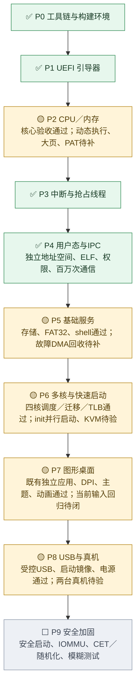
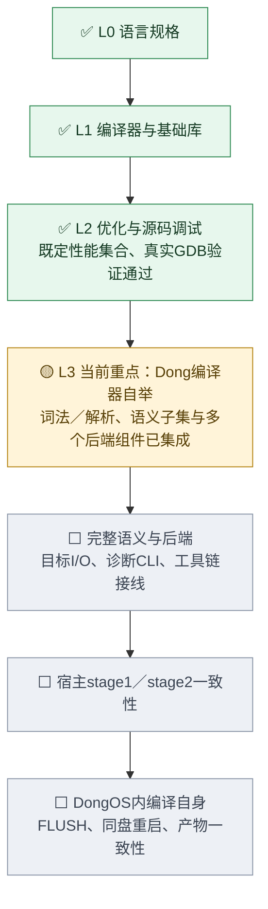

# DongOS 整体任务图

证据快照：2026-10-18 23:36（Asia/Shanghai）。范围为 P0–P9，P10 另定。当前重点是 **L3：Dong 编译器自举**。

已形成从 UEFI 启动到用户态图形桌面、文件持久化与四核用户调度的受控闭环。✅ 表示所列范围通过既定验收，🟡 表示阶段仍有未关闭环节，⬜ 表示原阶段门槛尚未完成。

本文件与 [roadmap.json](roadmap.json) 是按计划与验收记录核对的人工证据快照；控制台从 JSON 显示任务图，任务领取与验收统计仍读取协调器实时 snapshot。协作任务数量不代表整个操作系统的完成百分比。

## 系统主线

| 阶段 | 已通过的环节 | 尚未关闭的环节 |
| --- | --- | --- |
| P0 工具链 | 本地构建、调试、测试入口及自动启动验收 | 远程 CI 尚未执行；不计入本地通过结论 |
| P1 引导器 | 载荷校验、BootInfo、页表/栈交接、异常镜像拒绝、退出固件重试 | 所列 P1 本地门槛已关闭 |
| P2 CPU 与内存 | 异常、分配器、活动页表、保护位、四核 TLB shootdown | 动态执行物理别名策略、大页转换、PAT 写合并 |
| P3 中断与线程 | ACPI、APIC、受控定时回退、真实抢占、扩展寄存器保存 | 真实 TSC-deadline 硬件路径另补；现有验收不覆盖该硬件路径 |
| P4 用户态与 IPC | 独立根/ELF/句柄、百万 IPC、BSP PCID、正常内核能力通知与共享对象 | 所列受控 P4 门槛已关闭；新版首次启动归 P6/P7 |
| P5 基础服务 | 受控设备授权、键盘、三类存储、FAT32、shell、FLUSH/重启 | 同次启动的通用设备恢复、故障 DMA 安全回收/重分配/重授权 |
| P6 多核与快启 | 四核唤醒、用户抢占/迁移、跨代退休、IPI、计时时间线 | init 首次跨 AP 并行启动；Linux/KVM 引导器至 shell ≤0.5 秒 |
| P7 图形桌面 | 合成/字体/DPI/主题/动画、四独立应用、窗口生命周期、持久化 | 当前 R6 完整 GUI/输入回归及候选修复推广后的实际复验 |
| P8 USB 与真机 | 受控 xHCI/HID/BOT、USB 存储持久化、启动镜像、受控电源 | 一台台式机与一台笔记本；物理设备/Hub/热插拔另验；新版 USB 回归 |
| P9 安全加固 | NX、SMEP/SMAP、句柄隔离等基础保护已在前序阶段形成 | 安全启动、IOMMU、CET、内核基址随机化、模糊测试及原 24 小时门槛 |

P7 的既有功能验收仍保留；当前新镜像的完整输入/GUI 回归未关闭，因此图中采用部分完成。R6 GUI 全量复验和首次启动观察均有失败记录，不能用冒烟通过替代全量通过。

P2 旧清单仍含 PCID 未勾选及 PCIDE 关闭的历史描述。较新的 P4 记录已经证明 BSP PCID 生命周期与 VMware 标签保留；跨核 PCID 保留仍不能由 R6 UART 回归推断。图中不把旧勾选作为“PCID 整体未实现”的依据。

## 语言主线

L0 规格和 L1 编译器/六个标准库已完成本地验收。L2 的受控 SSA 优化、固定五项性能集合及真实 GDB 源码断点/单步/变量/展开已通过；结论限于既定集合，不表示所有函数均优化或客体内核调试已复验。

L3 已有 Dong 原生词法、解析、模块/名称、运行时语义子集，以及多个后端规划/发射组件的集成证据。下一步仍须补完整语义（方法、标签、错误与 defer 清理）、完整后端、目标 I/O/诊断 CLI/工具链，再完成宿主 stage1/stage2 和真正 DongOS 自编译、落盘与重启一致性。组件验收不能替代完整自举验收。

## 依据

- [总计划](../../code/PLAN.md)：语言线 338–363 行；系统阶段 365–479 行。
- [系统集成记录](../../code/docs/process-integration.md)：127 行为正常内核能力通知/共享对象/MSI 通过；131–139 行保留 R6 首次启动与 GUI 回归的未关闭结论。
- [语言线记录](../../code/docs/language-l2-l3.md)：30–46 行为当前 L3 进展与剩余顺序；98–104 行为 L2 固定性能集合通过；144–148 行为自举原门槛与后续系统回归现状。

本次只保存和展示任务图，没有执行 OS/VM，没有修改任务数据库、派生索引或验收/集成状态。
