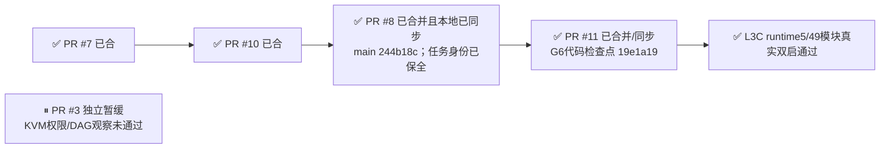
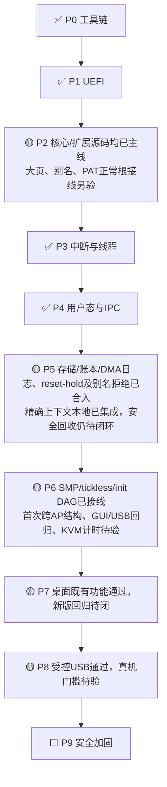
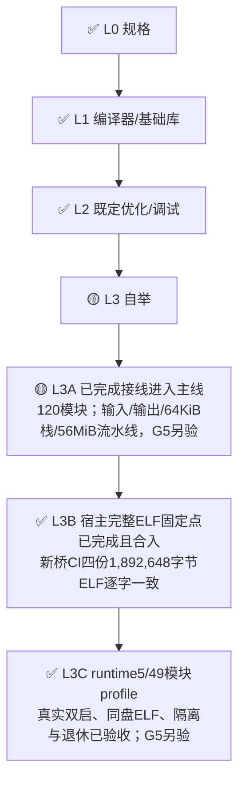

# DongOS 整体任务图

证据快照：2026-10-21 02:26:41（Asia/Shanghai）。G6代码合并/同步检查点19e1a19（PR#11于2026-10-21 02:20:34合并、2026-10-21 02:21:50本地快进同步），完整SHA `19e1a1982de0d7ebc57eea0b851d968e01b40e07`；与准确候选f54c35c同tree。G6已通过真实两启和双独审，L3C在现有runtime5/compiler_job隔离profile及49模块自编译闭包内complete；L3/L3A仍为G5 partial，L3B complete。P5CTX1本地integrated rev7及122=103 integrated+19 accepted保持，P2由Claude单独推进。

**G6代码已合并并保全同步，限定profile验收完成。** [公开执行/合并报告](reviews/2026-10-21-g6-ci-execution.md)及[JSON](reviews/2026-10-21-g6-ci-execution.json)保留两轮失败、第三轮成功及原始证据。M7/M8等历史环节中的“当前main/HEAD244b18c”属于PR8原检查点；最新G6代码合并/同步检查点以顶部及M11为准。后续文档提交可推进HEAD，不改变已验收的f54c35c代码/tree证据。

## GitHub集成门禁

**#7 → #10 → #8 → #11 已合并并同步；#3独立暂缓。** G6与P5各自保留阶段门禁，本地P5上下文修改不计入GitHub准确head验证。

| 环节 | 已完成 | 下一步 |
| --- | --- | --- |
| M0 已包含的历史分支：6项，无需重复合并 | PR#1/#2/#4/#5/#6/#9的分支均为GitHub main祖先，备份内容无遗漏；codex/p5-recovery-dma-journal；codex/p6-input-irq-fix；docs/p5-p6-engineering-handoff；docs/p5-p6-merged-checkpoint；dot/verified-components-console-20261020；dot/l3-host-checkpoint-20261020 | 所列集成范围已完成；阶段验收按各自门禁继续 |
| M7 PR#7：远端已合，本地主线已包含 | head3a5c773的专项、实际VirtIO reset guest、输入及完整CI通过；2026-10-20 21:29:25合并，merge 1dfebe1；只完成复位并持有DMA | 当前主线及本地HEAD244b18c已包含PR#7/#10/#8，无需重复合并；异机任务记录不导入本机调度；真实DMA排空、unpin/free/reuse和驱动恢复仍属P5后续门禁 |
| M10 PR#10：已合入远端与本地主线 | head1c00a6f的专项及完整CI通过，已正常合入main，merge d7468a1；PR#8已正常合并并完成本地同步；整块DMA别名拒绝、reset/hold和租约记录全部保留 | DMA排空/回收/设备恢复仍见P5，代码合并不关闭其阶段门禁 |
| M8 PR#8：已正常合并并同步本地主线 | 2026-10-20 23:02:01正常合并，merge244b18c；合并树与准确head50ab7cf完全相同，已包含PR#7/#10及P2/L3既有开发；准确head的完整CI39436523413、P5专项39436520689和输入专项39436523449均通过；27字节桥机器正反例和两seed模式完整原生ELF固定点已复核；本地主线于23:09:05快进至244b18c；120个bootstrap Dong模块、专用编译器栈、源/产物适配与WINVERIFY1执行器代码已可见；23:13合并同步冻结快照：56个原dirty文件已保全；533项本机state/任务书/交付文件SHA保持原样，另1个index仅由协调器正常更新generated_at；91项异机live路径仍隔离，foreign161条保留Git和ZIP，不导入本机调度；23:13冻结快照的官方DB为137任务/1129事件/120作业/1设置，逻辑SHA未变，活跃121项；此历史报告保持不改，本轮正式复验、验收/集成和新增P5CTX1另记录正常新rev，当前统计见本地协调轨道；stash2f286e8981a8283c65ce0a9dc9648ee9771e3bb8及.local/pr8-main-sync-20261020T150259Z保留可恢复副本；合并同步阶段未自动登记任务验收或集成，本轮后续登记保留原历史；合并后输入CI39444684432已通过，完整CI39444684378在本快照时仍运行；不把合并前准确head通过写成新push全量已通过，G6真实双启仍见L3C；23:13冻结时服务经HTTP与MCP核对为121项活跃任务，automation=false、issues=0；149项Python、11项UI JS、14项桥/NASM/启动宿主测试均0skip通过；其范围不替代本轮两项正式隔离复验 | 所列集成范围已完成；阶段验收按各自门禁继续 |
| M11 PR#11：G6代码已合并/同步，限定profile验收完成 | 准确候选f54c35c/tree394874cfe8ec7e4b0b4a9c857535781f88a957c6仅8个G6文件；FAT32分配I/O和生产日志解析修复有真实坏源及回归，不含P2或本地P5CTX1实现；G6 run39467503226 attempt1在准确headf54c35c通过真实同盘两启（304.834秒、307.193秒）；SEED/STAGE1/STAGE2各1892648字节且逐字等于宿主ELF，SHA256 e7f2424dc2010cf5b66e32c14faafec87f1f0f76051c04bd4e9eee050d34c9f2；432项源码与453项冻结输入按Git原始字节核验；两次共1810份物理转储经两位独审，64KiB栈/双guard、56MiB arena、只读源码借页、W^X和无能力隔离通过；每启128页退休表清零、core/借页撤销、controller恢复及真实FLUSH均通过；准确候选常规CI39467503240为20/20 success：712宿主测试0skip、931语言测试1项既有DONG_ASSEMBLER_FULL_INPUT条件skip、9组真实boot；P5 39467503250与输入39467503280通过。实际PR测试merge b905c1e、f54c35c与代码merge19e1a19同tree 394874cfe8ec7e4b0b4a9c857535781f88a957c6；G6代码合并/同步检查点19e1a19（PR#11于2026-10-21 02:20:34合并、2026-10-21 02:21:50本地快进同步），完整merge SHA 19e1a1982de0d7ebc57eea0b851d968e01b40e07；实际merge、本地检查点和已验收候选内容树相同；保全FF证明8项G6文件干净，其余307路径字节/删除态与cached diff原样；未使用reset/stash/restore，不导入foreign任务状态；合并后自动push检查在2026-10-20T18:20:41Z快照为39473893535 in_progress；39473893647 in_progress；与已通过的准确候选/同内容树检查分开，不冒称新push全绿，也不为重复CI阻塞此次集成。 | 仅本行声明profile/集成范围已完成；G5/P5等另验 |
| M3 PR#3：独立暂缓合并（工具已开发） | head288d65c的KVM/DAG验证工具和AP预筛已开发；三个共享输入文件已在main，剩余6个新增验证文件；不重复合并输入修复 | 不在M7→M10→M8合并队列；focused39425166102的KVM权限及首代DAG观察失败，应解决环境/观察门禁或另拆工具范围；保留真实失败，未取得KVM计时或首代结构成功证据前不标阶段验收通过 |

本次合并与本地同步依据见[合并/保全报告](reviews/2026-10-20-pr8-merged-local-sync.md)和[JSON记录](reviews/2026-10-20-pr8-merged-local-sync.json)。准确head的固定点及CI范围见[阻塞修复报告](reviews/2026-10-20-pr8-blockers-review.md)与[固定点实物核验](reviews/2026-10-20-pr8-fixedpoint-proof.json)。旧待合快照保留为历史证据。

## 系统主线

| 阶段 | 已完成的开发与证据 | 真实剩余项 |
| --- | --- | --- |
| P0 工具链与构建环境 | NASM、链接器、QEMU与UEFI固件可用；构建、调试、测试入口及本地自动启动验收通过；完整 CI 已拆为并行分片(ci.yml)，另有 p6-input 输入/USB 专用工作流；可复现基线夹具已修复 | 所列受控范围已完成 |
| P1 UEFI 引导器 | 载荷读取、解压、SHA-256校验与BootInfo交接通过；正常启动、篡改/截短/缺失拒绝及退出固件重试通过 | 所列受控范围已完成 |
| P2 CPU 与内存 | 主线异常/分配器/活动页表、NX/WP/W^X及四核TLB shootdown已有验收；ELF装载撤销supervisor写别名、发布隔离与销毁退休已实际接线；PR#8已合入主线并同步本地：2MiB live映射/拆分/合并与页表退休回收，含512项转换、PAT位重映射和既有真实双CPU探针记录；PR#8已合入跨地址空间物理别名W^X规划，以及PAT/MTRR有效类型、别名冲突检查、WC编码与缓存迁移 | 扩展源码已在主线；正常启动和active_paging实际使用大页、动态执行与WC的接线仍另验；恢复/复核既有原生与双CPU探针记录，再验证正常根撤权、SHOOTDOWN、转换与回收；TCG不证明WC真实性能 |
| P3 中断与抢占线程 | ACPI发现、LAPIC/IOAPIC与旧PIC屏蔽通过；受控定时回退与线程抢占、XSAVE/FXSAVE状态保存通过 | 所列受控范围已完成 |
| P4 用户态与 IPC | 独立地址空间、ELF加载、句柄权限与百万次真实IPC通过；BSP PCID生命周期及VMware标签保留通过；正常内核的通用能力通知、共享对象API通过 | 所列受控范围已完成 |
| P5 基础服务 | 主线受控设备授权、键盘、VirtIO/AHCI/NVMe、FAT32/shell与FLUSH同盘重启闭环已有验收；PR5已合入：恢复账本stop→quiesce→retire→reclaim→read→新代际发布，以及分配前PINNED/整块DMA归属记录；最新交接保存专项原生与完整CI通过记录；PR#7已合入GitHub主线：可信现代VirtIO停止后复位并持有DMA，专项/完整CI通过，含真实TCG control/fault；当前本地主线244b18c已包含；PR#10已正常合入GitHub主线（merge d7468a1）：普通USER分享拒绝完整DMA分配块别名；PR#8合并及本地同步后仍原样保留；P5CTX1由另一线程完成真实本地文件集成并登记integrated rev7：可信精确身份、完整DmaLease快照与退休观察已接入services/device_host；代码为本地未提交修改，不冒作本轮GitHub CI覆盖 | PR#7/#10/#8均已进入GitHub主线；P5CTX1精确持有上下文已本地集成、验收登记完成，尚未提交/推送；本轮G6仅保留该工作，不重复开发或接管；精确owner/incarnation、设备token/generation与根/代际/整块DmaLease上下文已接线；可信outstanding DMA排空、持续旧owner排除、全别名/根退休、unpin/free/reuse及恢复发布仍需真实闭环；同boot设备重授权/驱动重启及旧句柄/旧DMA/旧IRQ负控与持久化回归；reset-hold不能充作安全回收；P5CTX1保持reset confirmed与drain unknown分开，不修改memory回收、不发布新token或重启驱动；账本/日志/别名拒绝/reset-hold已完成，不重复派单 |
| P6 多核与快速启动 | 主线四核用户抢占/迁移/退休/IPI及tickless one-shot/idle停表已经开发并接线；正常runtime7启用P6_USER_SMP；init Kahn依赖图、ready_mask、普通AUTOSTART应用与首代归属已接线；不再列为待开发DAG；输入IRQ丢边沿修正已合入，专项与完整CI通过记录已在最新交接恢复；首次DAG观察器、严格KVM runner及负控已经在实验分支开发；失败记录也已保存 | PR#3 head288d65c的focused39425166102失败：首代AP/STARTING观察窗口未捕获，KVM权限探测因sudo需密码失败；合并独立暂缓，不重写已接线scheduler/init，也不记为KVM性能超时；新正常镜像GUI/键鼠/USB回归和实验验证工具差集集成；合法Linux/KVM环境下loader→interactive shell≤500ms；设备权限前置失败尚无成功性能结果 |
| P7 图形桌面 | 合成器、字体、DPI、主题、动画与真实输入功能已有验收；四个独立CPL3应用、窗口生命周期及文件/设置持久化已有验收 | 当前R6完整GUI及输入回归；输入修正已有原生、输入/USB专项及常规boot记录；新正常镜像的完整GUI/键鼠回归仍待关闭 |
| P8 USB 与真机 | 受控xHCI/HID/BOT、USB键鼠和USB主盘持久化通过；GPT/ESP启动镜像、QEMU实际USB引导及受控ACPI电源通过 | 至少一台台式机和一台笔记本实际启动验收；物理设备、Hub与热插拔等范围另验；当前新镜像USB集成回归待关闭 |
| P9 安全加固 | 原阶段门槛尚未完成 | 自有密钥签名、OVMF与真机安全启动；IOMMU限制驱动DMA；CET影子栈/间接跳转检查与内核基址随机化；系统调用/IPC模糊测试及原阶段24小时门槛 |

P5 的恢复顺序是 **stop → quiesce → retire → reclaim → read → 发布新代际**。reset-hold只证明停止后复位并继续持有DMA，不能当作outstanding DMA已排空、解除PINNED或驱动恢复。P2扩展源码现已主线，正常启动和active_paging使用这些能力仍按原范围另验。

## 语言主线

| 环节 | 已完成 | 剩余 |
| --- | --- | --- |
| L3 | 主线120个bootstrap Dong模块、66个nasm_组件；原生前端/诊断、通用IR/lowering/NASM、原生汇编器与宿主CLI已经接线；10个整函数组件已在主线文件集成并有5组真实组合测试；本轮逐项核对既有验收指纹、主线路径与有效负控；PR8保留161条异机原任务档案：109 integrated、27 accepted、23 paused、CX14 in_progress、CX15 submitted；其源码已合入，档案保留在Git、ZIP及恢复台账，不导入本机当前122项活跃调度；L3A输入/输出/64KiB栈/56MiB流水线和L3B完整ELF固定点已完成开发并进入主线，本地源码可见，原独审及正式复验记录保留；本机C52经新正式job c00f7299f5fb453a9d16d91ab5164d79完成6项零skip独立复验，accepted rev13→integrated rev14；主线组件早随PR8集成，本轮正常补记正式结果，不覆盖旧失败和时间线；现有runtime5/compiler_job隔离profile及49模块自编译闭包已完成真实G6验收并随PR#11合并/同步；G6 run39467503226 attempt1在准确headf54c35c通过真实同盘两启（304.834秒、307.193秒）；SEED/STAGE1/STAGE2各1892648字节且逐字等于宿主ELF，SHA256 e7f2424dc2010cf5b66e32c14faafec87f1f0f76051c04bd4e9eee050d34c9f2 | 主线代码已同步，本地任务身份和UI修改已保全；后续依据当前本地调度处理，不重复派发已完成的读取、栈、产物写入或入口桥开发；完整语言G5差分覆盖继续保留；当前自编译闭包不等于方法/错误/枚举/try/orelse/defer/完整ABI全部完成；异机CX14/CX15原状态保留为档案，不自动导入或改写；现有profile的真实双启已由本轮新证据闭合，更广完整语言G5仍待差分覆盖 |
| L3A | 主线原生frontend/diagnostics、program_ir→lower_program→nasm_program与宿主POSIX CLI已接线；主线已包含GUEST1～5、CR45/46及CX6/8的既有实现：有界路径/目录/源码读取、诊断、原生汇编输入、真实H_READ/H_WRITE/H_SYNC文件适配；原任务完成历史单独留档；主线已包含CX7的64KiB双guard编译器栈、CX10的既有64MiB帧池及CR47语义栈优化；旧16KiB开发阻塞已解决，原独审及正式复验记录保留；主线CX13 compiler_job在单56MiB arena内完成前端/压缩/后端/原生汇编与ELF输出，无宿主IR/汇编正文替代；27字节启动桥已修复并通过机器正反例；既有输入/输出/专用栈/纯编译流水线已在G6真实同盘两启验证，但仅限现有49模块profile | 完整语言、ABI与诊断覆盖仍属G5；现有runtime5/49模块profile的持久产物验收已见L3C，不因此关闭完整后端覆盖 |
| L3B | 早期49模块宿主stage1/stage2汇编、对象与C适配宿主可执行文件逐字节一致已有冻结记录；CX12紧凑x86编码与CX13完整原生自编译流水线已进入主线，原独审及正式复验历史保留；debug/release两种seed路径共四份ELF逐字一致；历史四份ELF均1892632字节，SHA256 cf19cd58e244835e142f5abc40c1ced98da3666b3ba4855080623bc638b606bc；64KiB guard栈/单56MiB arena及真实坏体记录保持原范围；原verification/source_stable/process_stopped、独审和指纹保留在异机Git/ZIP档案及恢复台账；源码已同步，不因ignored build未迁移撤销已完成开发事实；新27字节桥的准确head50ab7cf已在Linux CI通过完整固定点；debug/release四份ELF均1892648字节、逐字一致，SHA256 e7f2424dc2010cf5b66e32c14faafec87f1f0f76051c04bd4e9eee050d34c9f2；merge244b18c的树与该head相同，本机Windows映射失败不计成功；本轮G6两次客体生成的完整ELF与相同源码宿主固定点逐字一致；宿主NASM+C链和原生汇编器ELF链仍按各自证据记录 | CX15原异机任务身份保持历史档案；现有profile的客体固定点已见L3C，更广Python/Dong语言差分仍属G5，不代表完整L3完成 |
| L3C DongOS内自编译（runtime5/49模块profile） | 主线已包含CX14的P5隔离编译slot3、受限启动门、只读源码借页、core退出权限与controller真实文件持久化接线；原异机任务在途记录仅留档；真实VM已经运行，run-cc7b089dc2b4保留明确失败：SYSRET消耗RCX导致第4参数arena错误；不是从未运行；内核R10传参及27字节桥RCX←R10、host decoder已修复并进入主线，本地可见；宿主实际机器桥正反例通过；新真实双启结果按后续CI记录验收；PR#11已实际安装专用G6 workflow于独立分支，固定head/tree并重建完整fixture和runtime5/compiler_job内核；每次保留原始成功/失败证据；真实首轮写盘超时定位FAT32逐项重扫I/O，按扇区扫描与单次grow局部游标修复；第二轮533.094秒完成STAGE1持久写盘，完整1892648字节与宿主ELF逐字一致，但生产EBS解析门禁错误导致未进入第二启；G6 run39467503226 attempt1在准确headf54c35c通过真实同盘两启（304.834秒、307.193秒）；SEED/STAGE1/STAGE2各1892648字节且逐字等于宿主ELF，SHA256 e7f2424dc2010cf5b66e32c14faafec87f1f0f76051c04bd4e9eee050d34c9f2；432项源码与453项冻结输入按Git原始字节核验；两次共1810份物理转储经两位独审，64KiB栈/双guard、56MiB arena、只读源码借页、W^X和无能力隔离通过；每启128页退休表清零、core/借页撤销、controller恢复及真实FLUSH均通过；G6代码合并/同步检查点19e1a19（PR#11于2026-10-21 02:20:34合并、2026-10-21 02:21:50本地快进同步）；现有runtime5/compiler_job隔离profile及49模块自编译闭包完成。首轮超时与第二轮解析门禁失败完整保留，不改写成通过；G5和P5安全恢复仍独立保留 | 仅本行声明profile/集成范围已完成；G5/P5等另验 |

## 本轮正式协调进展

C52与CXNASM3的真实实现早已随PR8进入main244b18c；本轮通过新正式隔离复验、独立源码/契约及产物审查后，按原任务正常推进新rev。旧提交、失败、中断与None结算记录保留，不覆盖历史。

| 任务 | 已核实结果 | 当前状态与边界 |
| --- | --- | --- |
| claude:C52 | job c00f7299f5fb453a9d16d91ab5164d79；6 tests、0 skip、149.843秒；source_stable/process_stopped/execution_exited均true；源码及713项产物已独立审查 | accepted rev13→integrated rev14；仅限该模块，不代表L3/G6整体完成 |
| codex:CXNASM3 | job 4628b48597ad4fa4a0edb758628cc8a5；10 tests、0 skip、2.859秒；三项结算标志均true；实际NASM3.02双格式正反例及指纹已独审 | accepted rev5→integrated rev6；保留独立编号，不覆盖异机CX6 |
| cursor:P5CTX1 | 另一线程已正式复验、独审并本地集成；integrated rev7，job5ed94c53b4b84458a0a53b052c63b8c9为1test/0skip；[原集成报告](reviews/2026-10-21-P5CTX1-integration.md) | 本轮MCP只读核对；code/实际实现为本地未提交修改，保留其原样；drain仍UNKNOWN，P5未完成 |

P5CTX1接续真实DMA申请成功/失败和退休路径的owner/incarnation、旧device token/generation、root/memory generation与完整DmaLease记录，禁止覆盖旧身份；reset只记confirmed、drain保持unknown，不回收DMA、不发新token或重启驱动。既有账本、整块记录、别名拒绝和reset-hold不重做，P5仍partial。

G6 run39467503226 attempt1在准确headf54c35c通过真实同盘两启（304.834秒、307.193秒）；SEED/STAGE1/STAGE2各1892648字节且逐字等于宿主ELF，SHA256 e7f2424dc2010cf5b66e32c14faafec87f1f0f76051c04bd4e9eee050d34c9f2。432项源码与453项冻结输入按Git原始字节核验；两次共1810份物理转储经两位独审，64KiB栈/双guard、56MiB arena、只读源码借页、W^X和无能力隔离通过；每启128页退休表清零、core/借页撤销、controller恢复及真实FLUSH均通过。准确候选常规CI39467503240为20/20 success：712宿主测试0skip、931语言测试1项既有DONG_ASSEMBLER_FULL_INPUT条件skip、9组真实boot；P5 39467503250与输入39467503280通过。实际PR测试merge b905c1e、f54c35c与代码merge19e1a19同tree 394874cfe8ec7e4b0b4a9c857535781f88a957c6。合并后自动push检查在2026-10-20T18:20:41Z快照为39473893535 in_progress；39473893647 in_progress；与已通过的准确候选/同内容树检查分开，不冒称新push全绿，也不为重复CI阻塞此次集成。 见[公开执行报告](reviews/2026-10-21-g6-ci-execution.md)。

### 已识别的下一步

1. 现有runtime5/49模块profile的G6已验收并合入；继续完整语言G5差分覆盖，不重复开发源读取、专用栈、入口桥或同一profile。
2. P5CTX1已本地集成，保留其未提交实现和原任务历史；可信DMA排空、撤映射后全核退休、精确回收和设备恢复仍待后续真实闭环。
3. P2由Claude单独处理；P6/KVM与PR#3、P7/P8新版回归及真机门禁按原范围推进。
4. 新push CI按公开执行报告快照单列；既有同内容树验证足以完成此次G6集成，不冒称后续文档提交已通过相同检查。

## 异机任务档案与本地调度

[恢复台账](reviews/2026-10-20-cross-machine-task-ledger.md)及[JSON档案](reviews/2026-10-20-cross-machine-task-ledger.json)保留异机161条任务身份、原验证与指纹；91项异机live路径仍隔离，不执行higher-rev覆盖或导入。

23:13的[合并同步冻结报告](reviews/2026-10-20-pr8-merged-local-sync.md)保留当时137任务/1129事件/120作业/1设置逻辑SHA未变、活跃121项，以及533项本机记录SHA未变、index仅正常更新的证据。该报告保持原样；其后两项新正式复验、正常验收/集成和新增P5CTX1会产生新记录，不能把冻结结论当成当前DB未变。

当前总138项含16归档，非归档122项：integrated=103、accepted=19，todo/in_progress/submitted均0（本轮fresh MCP只读查询）。原异机同号异义的备份与独立编号保持。

WINVERIFY1执行器代码早已同步；C52和CXNASM3本轮分别通过新正式隔离复验并登记integrated rev14/rev6。旧submitted、process_stopped=None及中断作业保留在历史时间线，没有用新结果覆盖旧回执。

## 依据

- [G6真实执行、修复、独审与合并](reviews/2026-10-21-g6-ci-execution.md)及[JSON](reviews/2026-10-21-g6-ci-execution.json)：本轮准确head、同内容树CI及代码合并/同步检查点。
- [本轮P5/G6下一步](reviews/2026-10-20-p5-g6-next-actions.md)及[JSON](reviews/2026-10-20-p5-g6-next-actions.json)：保留当时正式复验与G6准备快照；当前实际执行、验收和合并以G6执行报告为准。
- [C52任务书](claude-works/tasks/C52-board.md)、[CXNASM3任务书](codex-works/tasks/CXNASM3-board.md)及[P5CTX1任务书](cursor-works/tasks/P5CTX1-board.md)：由协调器维护的原任务与本轮新任务入口。
- [PR8合并与本地保全](reviews/2026-10-20-pr8-merged-local-sync.md)及[JSON](reviews/2026-10-20-pr8-merged-local-sync.json)：merge、stash、逐项恢复、foreign隔离与DB逻辑指纹。
- [准确head固定点实物](reviews/2026-10-20-pr8-fixedpoint-proof.json)与[阻塞修复报告](reviews/2026-10-20-pr8-blockers-review.md)：新四份ELF、源码绑定、桥机器正反例及原CI范围。
- [主线接续记录](../../L3-RESUME.md)、[完整编译作业](../../code/docs/l3-compiler-job.md)与[语言门禁](../../code/docs/language-l2-l3.md)：已合入实现、历史范围和G5/G6后续。
- [P5/P6工程交接](../../code/docs/p5-p6-engineering-handoff.md)：reset-hold、DMA日志/别名、DAG失败及剩余真实门禁。
- [roadmap.json](roadmap.json)：控制台任务图的同源数据；旧GitHub快照及异机台账只作其对应时间的来源依据。

## 证据边界

- 图更新于2026-10-21 02:26:41 Asia/Shanghai；G6代码合并/同步检查点19e1a19（PR#11于2026-10-21 02:20:34合并、2026-10-21 02:21:50本地快进同步）。该SHA标识G6代码检查点，后续文档提交可推进HEAD；本地P5CTX1/UI/任务修改保留，Claude单独推进P2。
- PR#7/#10/#8均已合入并完成本地同步；PR#3独立暂缓。P5完整恢复验收不是PR8代码合并的前置，原DMA guard、hold和reset契约全部保留。
- 23:13合并同步冻结报告保留56个dirty文件、533项任务相关文件SHA和DB四表逻辑未变的当时证据；该报告不改。后续C52/CXNASM3新正式复验及正常验收/集成、新增P5CTX1正常产生新记录，不再宣称当前DB未变；91项异机live路径仍隔离。
- 开发已完成、主线已集成、阶段验收是三个不同事实。本机没有任务书或ignored build回执，不能据此判未实现；源码、git状态快照、正式verification与独立报告构成异机恢复依据。
- PR8的161条异机任务（含23条paused）保留Git、ZIP与恢复台账，不导入本机live状态；旧快照相对原主线新增27项只作来源对照，不当新待办或当前任务数。
- 原pool:P2ALIAS1/P2HUGE1/P2PAT1已取消归档；P2扩展后来直接在PR8开发，不恢复这些旧派单凑数量。
- 发现异机codex:CX6/ cursor:CR43与本轮临时新任务同号异义。临时记录已经官方pause/archive并备份，NASM维护改独立编号CXNASM3；不让higher-rev同步规则混合不同契约。
- WINVERIFY1执行器早已随PR8同步；C52本轮新正式复验6 tests/0 skip、149.843秒通过，source_stable/process_stopped/execution_exited均true，正常accepted rev13→integrated rev14。旧submitted/None及中断记录保留在原时间线，不覆盖回填。
- 当前本地非归档任务122项：integrated=103、accepted=19、todo=0、in_progress=0、submitted=0；总138项含16归档。P5CTX1另一线程正常验收/实际本地集成至rev7；本轮仅只读核对，异机161条仍未导入，也不是系统完成百分比。
- P5CTX1已由另一线程实现并实际本地集成，正式任务integrated rev7；相关源码为本地未提交修改，本轮保留，不冒作G6 CI覆盖。DMA排空/回收/恢复仍待真实门禁，P5 partial；G6独立推进。
- P6首代DAG真实结构观察失败与KVM前置权限失败保留；它们不否定已接线的scheduler/init实现。P7/P8新版GUI/USB回归及外部真机门槛继续保留。
- 绿色L3B为有界宿主固定点；L3C的现有runtime5/compiler_job隔离profile及49模块自编译闭包已完成真实两启及持久产物验收。整体L3/L3A仍因G5完整语言覆盖保持partial。
- GitHub集成状态与阶段验收分开：本轮G6以真实两启、原始磁盘/物理转储及双独审通过，不仅依据CI绿色；P5/P2/G5不由该结论关闭。
- 本机Windows完整固定点两次均在seed执行前因固定ELF地址占位而失败，未计通过；临时链接尝试撤回，完整固定点由准确head的Linux CI及源码绑定回执证明。
- PR8合并前准确head三组CI均通过；main244b18c的完整CI39444684378 attempt2已20/20 success，原apt源403失败保留。PR11各候选head和各次实际G6结果单列，不跨head沿用绿色。
- 23:13同步验证的149项Python回归81.274秒、11项UI JS及14项桥/NASM/启动宿主检查17.529秒保持原范围。本轮C52与CXNASM3另有正式隔离复验和正常新rev集成；本轮计数以协调器122项为准，不替代G6客体双启。
- CXNASM3新正式复验10 tests/0 skip、2.859秒通过，source_stable/process_stopped/execution_exited均true，经独审accepted rev5→integrated rev6；独立身份与异机CX6及旧临时记录分开。
- G6 run39467503226 attempt1在准确headf54c35c通过真实同盘两启（304.834秒、307.193秒）；SEED/STAGE1/STAGE2各1892648字节且逐字等于宿主ELF，SHA256 e7f2424dc2010cf5b66e32c14faafec87f1f0f76051c04bd4e9eee050d34c9f2；432项源码与453项冻结输入按Git原始字节核验；两次共1810份物理转储经两位独审，64KiB栈/双guard、56MiB arena、只读源码借页、W^X和无能力隔离通过；每启128页退休表清零、core/借页撤销、controller恢复及真实FLUSH均通过。首两轮失败仍在公开执行报告中，不覆盖历史。
- 旧P5/G6下一步报告与静态提案保留为历史；当前G6实施、真实失败、修复及各head CI以2026-10-21-g6-ci-execution.md为准，不能继续把提案未运行写为当前状态。
- M7/M8等历史环节中的“当前main/HEAD244b18c”属于PR8原检查点；最新G6代码合并/同步检查点以顶部及M11为准。后续文档提交可推进HEAD，不改变已验收的f54c35c代码/tree证据。
- 准确候选常规CI39467503240为20/20 success：712宿主测试0skip、931语言测试1项既有DONG_ASSEMBLER_FULL_INPUT条件skip、9组真实boot；P5 39467503250与输入39467503280通过。实际PR测试merge b905c1e、f54c35c与代码merge19e1a19同tree 394874cfe8ec7e4b0b4a9c857535781f88a957c6
- 合并后自动push检查在2026-10-20T18:20:41Z快照为39473893535 in_progress；39473893647 in_progress；与已通过的准确候选/同内容树检查分开，不冒称新push全绿，也不为重复CI阻塞此次集成。
- P5CTX1 integrated rev7仅为另线程本地实际集成；本轮G6提交/CI不包含这些未提交修改。当前122活跃任务为103 integrated、19 accepted，16归档、总138；本轮未改状态。
