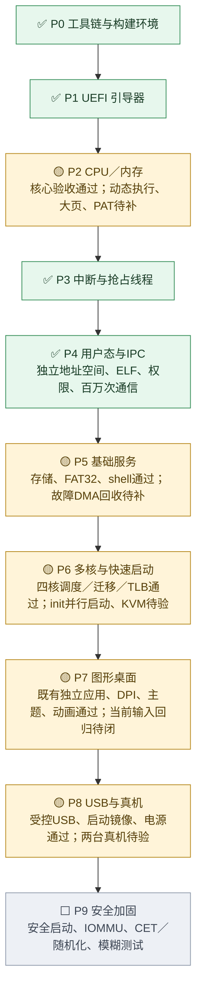
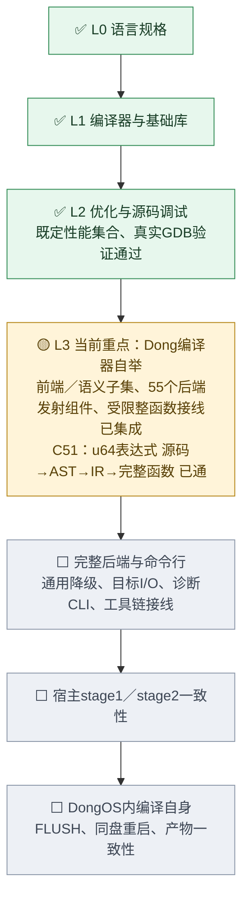
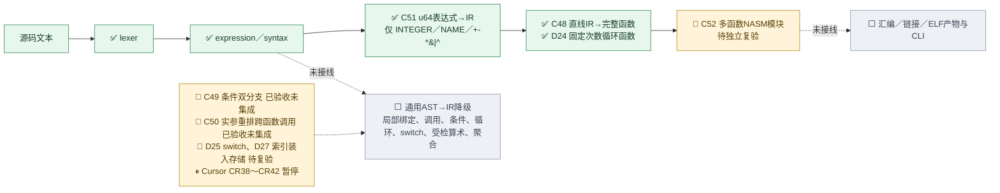

# DongOS 整体任务图

证据快照：系统主线 2026-10-18 23:36，语言主线 L3 于 2026-10-19 23:32 重算（Asia/Shanghai）。范围为 P0–P9，P10 另定。当前重点是 **L3：Dong 编译器自举**。

已形成从 UEFI 启动到用户态图形桌面、文件持久化与四核用户调度的受控闭环。✅ 表示所列范围通过既定验收，🟡 表示阶段仍有未关闭环节，⬜ 表示原阶段门槛尚未完成。

本文件与 [roadmap.json](roadmap.json) 是按计划、验收记录和代码实际状态核对的人工证据快照（2026-10-19 起语言主线按 `code/lang/bootstrap` 与协调器实时状态重算；系统主线自上次快照后 `code/` 下除 `lang/` 外没有源码或 PLAN.md 变化，状态与证据沿用）；控制台从 JSON 显示任务图，任务领取与验收统计仍读取协调器实时 snapshot。协作任务数量不代表整个操作系统的完成百分比。

## 系统主线

| 阶段 | 已通过的环节 | 尚未关闭的环节 |
| --- | --- | --- |
| P0 工具链 | 本地构建、调试、测试入口及自动启动验收 | 远程 CI 尚未执行；不计入本地通过结论 |
| P1 引导器 | 载荷校验、BootInfo、页表/栈交接、异常镜像拒绝、退出固件重试 | 所列 P1 本地门槛已关闭 |
| P2 CPU 与内存 | 异常、分配器、活动页表、保护位、四核 TLB shootdown | 动态执行物理别名策略、大页转换、PAT 写合并 |
| P3 中断与线程 | ACPI、APIC、受控定时回退、真实抢占、扩展寄存器保存 | 真实 TSC-deadline 硬件路径另补；现有验收不覆盖该硬件路径 |
| P4 用户态与 IPC | 独立根/ELF/句柄、百万 IPC、BSP PCID、正常内核能力通知与共享对象 | 所列受控 P4 门槛已关闭；新版首次启动归 P6/P7 |
| P5 基础服务 | 受控设备授权、键盘、三类存储、FAT32、shell、FLUSH/重启 | 同次启动的通用设备恢复、故障 DMA 安全回收/重分配/重授权 |
| P6 多核与快启 | 四核唤醒、用户抢占/迁移、跨代退休、IPI、计时时间线 | init 首次跨 AP 并行启动；Linux/KVM 引导器至 shell ≤0.5 秒 |
| P7 图形桌面 | 合成/字体/DPI/主题/动画、四独立应用、窗口生命周期、持久化 | 当前 R6 完整 GUI/输入回归及候选修复推广后的实际复验 |
| P8 USB 与真机 | 受控 xHCI/HID/BOT、USB 存储持久化、启动镜像、受控电源 | 一台台式机与一台笔记本；物理设备/Hub/热插拔另验；新版 USB 回归 |
| P9 安全加固 | NX、SMEP/SMAP、句柄隔离等基础保护已在前序阶段形成 | 安全启动、IOMMU、CET、内核基址随机化、模糊测试及原 24 小时门槛 |

P7 的既有功能验收仍保留；当前新镜像的完整输入/GUI 回归未关闭，因此图中采用部分完成。R6 GUI 全量复验和首次启动观察均有失败记录，不能用冒烟通过替代全量通过。

P2 旧清单仍含 PCID 未勾选及 PCIDE 关闭的历史描述。较新的 P4 记录已经证明 BSP PCID 生命周期与 VMware 标签保留；跨核 PCID 保留仍不能由 R6 UART 回归推断。图中不把旧勾选作为“PCID 整体未实现”的依据。

## 语言主线

L0 规格和 L1 编译器/六个标准库已完成本地验收。L2 的受控 SSA 优化、固定五项性能集合及真实 GDB 源码断点/单步/变量/展开已通过；结论限于既定集合，不表示所有函数均优化或客体内核调试已复验。

L3 已有 Dong 原生词法（UTF-8/Unicode）、解析、模块/名称/绑定、运行时语义子集，以及主线 `code/lang/bootstrap` 里 93 个 Dong 模块（其中 55 个 `nasm_` 发射/门禁组件：比较、分支、移位、调用/参数/返回、原子、内存内建、checked 算术与窄化、切片/越界/除法门禁、switch 分发、作用域清理、静态指针重定位等）。C45 能生成内核可验证的静态 ELF64 代码/数据镜像，D23 能逐字节比较产物。

**受限整函数接线（2026-10-19 新增）**：C48（直线 u64 IR → 完整 SysV 函数）与 D24（固定次数 u64 循环函数）已集成；C51 把真实 lexer + parser 产生的 `INTEGER / NAME / + - * & | ^` 表达式树降为 C48 的 IR，已集成。这是第一次打通"源码文本 → token → AST → IR → 完整函数 → 汇编 → 真实调用"，但只限 u64 单表达式，不是通用编译器后端。

| L3 环节 | 当前状态（协调器 2026-10-19 23:30） |
| --- | --- |
| 已集成 | 前端与语义子集、55 个 `nasm_` 组件、C48、D24、C51、C45（ELF64 镜像）、D23（产物比较） |
| 已验收、尚未集成 | C49（条件比较与双分支返回）、C50（实参重排与真实跨函数调用） |
| 已提交、待独立复验 | C52（多函数 NASM 模块与可链接导出）、D25（有界 i64 switch 函数）、D27（有界索引装入/存储函数） |
| 暂停 | Cursor CR38～CR42（受检 64 位算术与错误返回、AND/OR 短路、双字返回清理、窄算术、切片视图） |
| 尚未开始 | 通用 AST→IR 降级与统一后端、目标 I/O/诊断 CLI/工具链接线、宿主 stage1/stage2、DongOS 内自编译 |

协调器全表此刻共 120 项：已集成 91、已验收未集成 21、待复验 3、暂停 5；它们是协作任务数，不代表系统或 L3 的完成百分比。

下一步仍须补完整语义（方法、标签、错误与 defer 清理）、把各受限组件统一进完整后端、目标 I/O/诊断 CLI/工具链，再完成宿主 stage1/stage2 和真正 DongOS 自编译、落盘与重启一致性。组件验收不能替代完整自举验收。

## 依据

- [总计划](../../code/PLAN.md)：语言线 338–363 行；系统阶段 365–479 行。
- [系统集成记录](../../code/docs/process-integration.md)：127 行为正常内核能力通知/共享对象/MSI 通过；131–139 行保留 R6 首次启动与 GUI 回归的未关闭结论。
- [语言线记录](../../code/docs/language-l2-l3.md)：30–46 行为当前 L3 进展与剩余顺序；98–104 行为 L2 固定性能集合通过；144–148 行为自举原门槛与后续系统回归现状。该文档的 L3 新增条目停在 CR28/CR29，尚未写入 C48/D24/C51 的集成；这里以代码和协调器状态为准。
- 受限整函数接线的源码：`code/lang/bootstrap/nasm_u64_function.dg`、`nasm_u64_loop_function.dg`、`u64_expression_ir.dg`（各带同名 `.md`），永久测试在 `code/lang/tests/test_bootstrap_nasm_u64_function.py`、`test_bootstrap_nasm_u64_loop_function.py`、`test_bootstrap_u64_expression_ir.py`。
- 集成与验收记录：[C48 集成与 C49/C50 复审](reviews/2026-10-19-C48-integrated-C49-C50-R1.md)、[C51/D24 集成](reviews/2026-10-19-C51-D24-integrated.md)。

本次只更新任务图文档（`roadmap.json`、本文件），没有执行 OS/VM，没有修改源码、任务数据库、派生索引或验收/集成状态。
